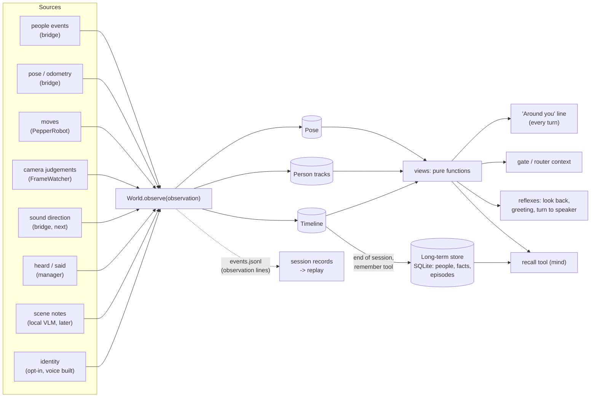

# Memory: where Pepper keeps what it knows

Status: built offline in 0.6.0 (2026-10-08), slices 1 to 5 of the build order; tested in unit tests, on the virtual Pepper and on replays of recorded sessions, not yet on the robot (the checks are in `HANDOFF.md`, "Before the next robot session"). Voice identity (slice 6) was built offline on 2026-11-05 and has not run on the robot either; the face side is still to come. This document is the plan that Milestones 4 and 5 and issues #27, #12, #24, #11, #13, #14 build on, so that each new piece plugs into one structure instead of being wired to the others by hand. `ARCHITECTURE.md` places it among the layers; this is the detail.

It was drafted with an independent proposal from a second model (Claude Fable 5.1, asked to read the code and the robot session records). The two agreed on the shape. The proposal's sharpest point is kept here: remembering where someone stood a minute ago and remembering someone's name next week are different problems. They share a vocabulary, but not a store.

## What went wrong without it

From the robot session on 2026-10-08 (`docs/HANDOFF.md`):
- After "turn ninety degrees", the person was out of view, and "turn towards me" had nothing to go on. Pepper asked "left or right?" and needed four turns to face them again. Replaying that session by hand shows that simply keeping count of Pepper's own turns would have predicted where the person reappeared (-50.9° predicted, -50.4° seen).
- "Come to me" failed because NAOqi's detector loses people every few seconds.
- The addressee judgement never saw what Pepper itself had just said.
- Conversation state is scattered across the manager in half a dozen timestamps.
- Nothing survives a restart, so Pepper cannot remember anyone.

## Two tiers, one vocabulary

| | Working memory (the world model) | Long-term memory |
|---|---|---|
| Holds | where Pepper is and which way it faces; who is around and where, including people just out of view; what just happened (moves, what was said by whom, camera events, scene notes) | people who chose to be remembered, facts about them and the lab, a short record of each session |
| Lifetime | seconds to minutes; gone at restart (the odometry frame resets with NAOqi anyway) | weeks; deleted on request or when it expires |
| Personal data | positions and recent words, as in the session records | names, facts, later face or voice identity: opt-in only |
| Code | `src/world/` (exists: `WorldModel`) | `src/memory/` (new) |
| Storage | in-process, bounded | one SQLite file on the host (`MEMORY_DIR`), git-ignored |
| Read on every turn | yes, as one "Around you" sentence (no model call, a few dozen numbers) | no; through a `recall` tool when the mind needs it, plus a one-line hint when a known person is present |

The shared vocabulary is in `src/world/` and is the only thing both tiers import:

- **Observation**: one thing a sensor or judge reported. Fields: `source`, `kind`, `at`, `frame`, `confidence`, `data`. Append-only.
  - Sources: `people`, `pose`, `motion`, `camera`, `sound`, `scene`, `heard`, `said`, `identity`, `mind`.
  - Frames: `body`, `head`, `odom`.
- **Pose**: Pepper's own position and heading `(x, y, theta)` in the odometry frame, with how it is known (`measured` from the bridge or `dead_reckoned` from commanded moves) and whether it is uncertain.
- **PersonTrack**: one person as the host follows them. Fields:
  - a host-assigned id (NAOqi's ids change whenever it loses someone), first and last seen;
  - position in the odometry frame when the distance is known, otherwise a bearing only;
  - gaze, distance, when they last spoke and were answered;
  - later, an identity (a long-term person id and a confidence) and a name.
- **Event**: an entry in the timeline. Kinds: arrival, departure, greeting, move (asked and measured), utterance heard (with the addressee verdict), sentence said by Pepper, camera event, scene note, "moved unexpectedly".

## Flow



Rules:
1. **One way in.** Everything that changes what Pepper believes goes through `WorldModel.observe()`. A new sense is a new module that emits observations with a new `source`. It never touches the tracks or the readers directly.
2. **Readers are pure functions** over the state, in `src/world/views.py`. A new use is a new function.
3. **Nothing on the read path calls a model.** Local models (decision models, a scene model, identity) are sources. They write observations with probabilities, ahead of time.
4. **Only the mind speaks.** Memory never produces speech. It gives the mind a sentence of context and answers its questions.
5. **Never overwrite a known value with "unknown".** A people report without a position must not erase the last known bearing. The 2026-10-08 records have such a report.
6. **Every association is visible.** When a report is matched to a track, or a new track is made, the decision goes into the timeline and the session records, so a bad match shows up in review.
7. **Replayable.** The raw inputs (people events, poses, moves with their measured result, sound, scene notes) are written to `events.jsonl`. `scripts/replay_world.py` feeds a recorded session back through `observe()`, and tests compare the result with what was recorded.

## Frames: keeping directions true while Pepper turns

- **Body frame:** x forward, y left, angles positive to the left (the `turn` tool's convention). NAOqi's people positions arrive in the torso frame, which turns with the base, so the `yaw` in today's people events is already body-relative.
- **Head frame:** the camera. Anything judged from an image (left/centre/right, a point in a photo) is head-relative and must carry the measured head angles (`Photo.head_measured`) to become a body bearing.
- **Odometry frame:** NAOqi's `FRAME_WORLD`, read with `ALMotion.getRobotPosition(True)`. It is fixed from NAOqi start-up and integrated from wheel odometry. On the virtual Pepper a `moveTo(0, 0, 90°)` moved theta by exactly 90.0° and a 0.3 m drive moved x/y by 0.30 m (probe, 2026-10-08). On the robot, turns of ±30° measured 31° (2026-09-22).

Conversions:
- A person seen at body bearing `b` and distance `d` is stored at `(x, y) = pose ⊕ (d cos b, d sin b)` in odometry.
- Their bearing now is `wrap(atan2(y - y_r, x - x_r) - theta)`.
- A turn changes only `theta`; a drive changes the position, and every stored bearing follows from the geometry.
- A person with a bearing but no distance (sound, or a detector report without distance) is stored as a bearing in odometry. It goes stale after the base drives more than about 0.3 m.

Until the bridge reports the pose, the host dead-reckons from its own completed moves (`PepperRobot.turn`, `move_forward`, `move_to`). An interrupted move marks the pose uncertain until the next measured pose arrives.

**Moved unexpectedly:** if the measured pose jumps (more than 15° or 0.3 m from the estimate) while no move of the host's is running, a "moved unexpectedly" event is raised. Causes: someone pushed or carried Pepper, or NAOqi moved the base itself (the desktop NAOqi turns it ±54° while waking up). Every stored position is then demoted to "last seen N s ago, direction unknown".

## People tracks

- **Tiers by age:**
  - *present:* in the latest report.
  - *lost:* not reported for under 5 s, the detector's usual dropouts.
  - *remembered:* a position under 2 minutes old; people move, so older positions are worth little.
  - *gone:* kept in the timeline only.
- **Matching:** single hypothesis, deliberately simple. A report is matched to the nearest track within 20° and 0.7 m (on a tie, the most recently seen). Unmatched reports start new tracks; tracks missing from a report become *lost*. Two people standing close together can be confused; the logged associations let us tune this from the records.
- **NAOqi's count stays authoritative** for arrivals and greetings (today's rules in `WorldModel.update_people` are kept unchanged), so the greeting behaviour verified on the robot does not move.
- **Hints by source:** sound direction (#12) and camera left/right judgements (#24) attach to the nearest track or create a bearing-only one. Identity (#14) attaches a long-term person id to a track.

## What the mind sees

- **Every turn,** one "Around you" sentence. It is today's sentence plus, when nobody is in view and someone was seen in the last two minutes: "you last saw someone 12 s ago, about 90° to your right of where your body points now (turn -90 to face where they were)". It stays one sentence; it is in the dynamic block after the cached prompt, so caching is untouched.
- **A known person around** (opt-in identity, below) adds a short hint: "Mira is here (you know them: say recall to look them up)". The hint carries no facts, so the prompt does not grow.
- **The `recall` tool** (#12, #13) answers detail questions from working memory first, then the long-term store:
  - who was here and where, with ages;
  - Pepper's last moves;
  - the last scene note;
  - the last things said;
  - facts and past sessions about a person.
  It costs one extra model round (about 2 s), which is why everything needed every turn stays in the one sentence.
- **The `remember` tool** (#13) stores a fact the person asked Pepper to remember, or a name they gave, only when the person agreed to be remembered (below).

## Long-term memory

`src/memory/store.py`, using the standard library's `sqlite3` in WAL mode, with one file at `MEMORY_DIR` (default `results/memory/pepper.sqlite`, git-ignored):

```
people   (id, name, consent_at, consent_note, created_at, last_seen_at, expires_at)
identity (person_id, kind: face|voice, model, embedding, samples, consent_note, created_at)     -- only with consent
facts    (id, person_id or NULL for the lab, text, source: person|mind, session, created_at, expires_at)
episodes (session, started_at, ended_at, people, summary)                -- written by code at the end of a run
```

Rules:
- **Nothing is written automatically from working memory.** Writes happen only:
  - through the `remember` tool;
  - through enrolment (a name, later identity), after a spoken "yes" to a question like "Shall I remember you next time?", with the consent noted;
  - through a per-session episode row computed by code: who, how long, what happened, without quotes. People who did not consent appear only as counts.
- **"Forget me"** (an intent) deletes the person's row, identity and facts in one transaction and says so.
  - Identity and personal facts expire after 90 days unless the person renews consent. The exception is below ("Identity").
  - A sweep runs at start-up.
- **The sign and the docs must say** that "forget me" clears the memory store. Session records are separate development records with their own retention (lab practice), and one switch does not clear both.
- **Search:** plain-text search (SQLite FTS5) over facts and episodes. Embeddings are an option once there are enough facts to need them, through a local embedding model on the GPU machine. The store keeps the text, so an index can be rebuilt at any time.

## Session records and replay

The world model's inputs go into `events.jsonl` as `observation` lines, next to today's kinds:
- `pose` and `move` lines, with the measured result;
- `sound` and `scene` lines, when those exist.

Derived state (the "Around you" string already in `turns.jsonl`) is recorded for checking, never replayed from. `scripts/replay_world.py <session>` rebuilds the world model from a session and prints what it would have said at each turn. The replay script runs on the local session folders only. Tests use hand-written fixtures built from numbers already published in issues and HANDOFF, because session records never leave the host.

## How each issue fits

| Issue | Lands in |
|---|---|
| #27 remember where people were | pose in the odometry frame (bridge `pose` in the sensors snapshot, a `pose` event when it changes, the measured pose returned by moves); tracks with positions; the "Around you" line for people out of view |
| #12 sound localisation, detail tool | sound: a bridge `sound` event (`ALSoundLocalization`, dropped while Pepper speaks) and a `sound` observation; detail: the `recall` tool |
| #24 come to me | the voice's direction (sound heard during the utterance), else the nearest remembered track; then turn and drive as today. The camera fallback (built in 0.7.0) is a `person_seen` camera observation: while the detector sees nobody during a conversation, Clef Flash says which third of the frame the nearest person is in, and the head angles that come with each frame turn that into a direction |
| #11 periodic vision pass | a `scene` observation (short text, pose, head angle) every 10-20 s and when the people change; "last look N s ago" in the summary; detail through `recall`; frames never stored |
| #13 memory tools | `remember` / `recall` over `facts` and `episodes` |
| #14 face or voice identity | an `identity` source that compares embeddings on the host and attaches a long-term person id to a track; enrolment only through the consent flow |
| #18 follow me | a reader: short moves from the track's bearing and distance; stops when the track is lost for over 2 s |
| #6, #7, #28 look at, verify, point | readers: a target from a track or the last photo (shared pixel-to-angle maths with the head pose); verify compares the track before and after |
| #25 the gate sees what Pepper said | `addressee_context()` from the timeline (the last things heard plus Pepper's last sentence and its age); the judgement's wording changes, so the replays are re-run first |
| Reflection loop (first slice 0.7.0) | a reader that looks at the timeline every so often and raises an event turn for the mind (`src/ai/reflection.py`) |
| #31 voice direction accuracy | weight a voice's direction by how many sounds it rests on and their spread; check the azimuth frame against the head pose; after a turn to a voice that finds nobody, try the opposite direction |
| #32 things seen as people | a "static" mark on tracks that never move and sit at the same bearing from the same place (a monitor, 2026-10-20), so they stop counting as people present; person_seen from the camera alone counts less |
| #30 expect, then check | an `expected` observation left by each action with a visible effect (built from working memory); a reader compares it with the next pose, people or camera observations and notes a mismatch as a timeline event; the replay script can score expectations on recorded sessions |

## Build order

The store comes first, so the place where remembering people goes exists before anything feeds it. Each slice keeps the robot working (the robot runs the 0.5.1 bridge until the next deploy, so everything must work without the new bridge fields) and is tested offline before the next robot session.

1. **The core and the long-term store.**
   - The core: the shared vocabulary (`Observation`, `Event`), `WorldModel.observe()` and the timeline.
   - The store: `src/memory/` (people, facts, episodes, consent, forget, expiry sweep).
   - The tools and intents: `remember`, `recall` (store and working memory) and the "remember me" / "forget me" intents.
   - An end-of-session episode written by code.
   - Tests use a temporary SQLite file.
2. **Frames, pose and tracks** (#27).
   - Host: `frames.py` and `tracks.py`, with the "Around you" line for people out of view. Dead reckoning from the host's own completed moves is the default path. `WorldModel` keeps its interface.
   - Bridge: the measured pose in the sensors snapshot and in people events; a `pose` event only when the pose has settled after changing by more than 5° or 0.1 m (no stream during a turn); the measured pose in move results. Mirrored in the fake bridge, the fake NAOqi and `BRIDGE_API.md`.
   - Session records: pose and move observations, so sessions can be replayed (`scripts/replay_world.py`, local files only).
   - Tests:
     - unit tests for turn, drive, moved unexpectedly and "never overwrite with unknown";
     - a hand-written fixture with the numbers already in #27 and HANDOFF (turn 70 → person at -0.9°; then +90, +180, -160, -60 → seen again at -50.4°). Session files never go into `tests/`.
     - the virtual Pepper for the bridge pose.
3. **Conversation in the timeline** (#12 detail, #25 groundwork).
   - Heard and said utterances go into the timeline; the manager's scattered timestamps read from it.
   - `addressee_context()`.
   - The gate's wording stays as benchmarked: the 2026-10-01 log has no record of Pepper's sentences, so adding "Pepper just said" waits for a two-person session recorded with them (session records have them since 0.5).
4. **Sound direction** (#12, #24).
   - Bridge `sound` events, the `speaker_bearing` view, and "come to me" from the voice's direction.
   - Tested with the fake NAOqi; the desktop NAOqi has no `ALSoundLocalization`, so the robot verifies it.
5. **Scene notes** (#11): built. Clef Flash (who is where) and qwen3.5:4b (the place) write `scene` observations; the "Around you" line adds "Your last look around (12 s ago): ..." while fresh, and `recall` returns the details (benchmark below).
6. **Identity** (#14): voice and face built, offline (below).

## Models for the later slices (survey 2026-10-08)

Alien3 (RTX 5090, 32 GB) has about 10 GB of GPU memory free next to Nimble and Clef Flash. Candidates found in a survey of recent releases. Release details are from the publishers' pages and are not yet checked on our machine; each is benchmarked on recorded data before it is used.

| Use | First to try | Notes |
|-----|--------------|-------|
| Searching facts and episodes | plain-text search (SQLite FTS5) | enough at this scale. If needed later: `embeddinggemma-2` (Google, Apache-2.0, 270M text encoder with optional image and audio encoders; needs Ollama 0.40 and the bf16 tags) or `qwen3-embedding:0.6b` |
| Per-frame questions (who is where: left/centre/right, how many) | Clef Flash, as today (up to 64 typed questions per image in one call) | Liquid's `d1-3B` (October 2026, a 3B decision model, transformers only) is reported much faster; worth a benchmark |
| Scene notes (#11) | **built:** who is where from Clef Flash's typed questions, the place from `qwen3.5:4b` (benchmark below) | for boxes and pointing later (#6, #28): Moondream 3.1 (detect/point/caption, about 0.15 s; may need the GPU to itself), Molmo2-ER (pointing) |
| Finding a named object | the boxes from the scene model above | YOLOE-26 (open vocabulary, AGPL) if a dedicated detector is needed |
| Face and body identity (#14) | InsightFace 2.1 PersonAnalysis (`cheetah_s`: face and body detection, ArcFace, body re-identification) | library MIT, **pretrained models for non-commercial research only**; fine for the lab, a problem for anyone deploying it commercially |
| Voice identity, telling voices apart | speaker embeddings from sherpa-onnx (CAM++, TitaNet; already a dependency, runs on the CPU) | could also help the addressee gate: a second voice is evidence of side talk |
| Memory frameworks | none (our own store) | mem0, Graphiti and cognee all use a language model to extract memories; Graphiti's time-aware facts are worth revisiting if facts start changing over time |

### Scene notes: what the benchmark showed (2026-10-08)

12 frames from the robot's own photos, labelled by hand (6 with one real person, 6 with nobody but glass walls and Pepper's reflection), at the stream's 320×240:

| Asked | Model | People count right | Count and where right | Time per frame |
|-------|-------|--------------------|-----------------------|----------------|
| typed questions ("how many real people", "where is the nearest") | Clef Flash | 11/12 (the miss came with p 0.53) | 10/12 | 0.14 s |
| a description with a people list, JSON schema | qwen3.5:4b | 7/12 (8/12 when warned about reflections) | 7/12 | 0.62 s |
| the same | gemma4:e4b (QAT) | 0/12 (2/12 warned) | 0/12 | 0.61 s |

The generative models count people in glass reflections and in Pepper's own reflection, even when told not to. So the scene pass (`src/perception/scene.py`) asks each model what it is good at. Clef Flash says who is where, with a probability. qwen3.5:4b describes only the place and the objects, with people left out of its schema; those notes matched the frames, at a median of 0.46 s. Both run in parallel on frames the camera stream already sends, once when someone comes into view and then every 20 s; a look takes about 0.5 s end to end. The scripts and the labels are in `results/system-one/` (local only, because the frames show people).

## Identity (#14, #25; voice and face built 2026-11-05, not yet on the robot)

Three switches, all off by default and all needing `MEMORY_DIR` and someone enrolled. A match is a social cue and never authentication (`docs/SAFETY.md`). The face side is below ("Faces"); this part is about voices. `VOICE_ID` tells the mind "The voice sounds like *name*." for that turn, when confident, and hands the match to working memory as an `identity` observation (`recognised`), which goes on the track that just spoke, into the timeline and into `recall`; long-term memory notes `last_seen` and the session episode. It is a hint and not a login: it does not link them to the conversation the way telling Pepper their name does. `SECOND_VOICE` makes the addressee gate stricter while two people are talking (below).

**What is kept.** One row per person, kind and model in `identity`: the centre of their clips' embeddings, the model's name, the number of clips, a consent note and the date. No audio, ever. `kind` is `voice` or `face`. Someone not enrolled has no row, and each utterance's audio and embeddings live only for the length of the comparison, on the host's CPU or, with `VOICE_ID_URL`, also on the GPU machine: nothing of it reaches a file, there or here, and what is enrolled never leaves the host (the session recording `VOICE_RECORD_DIR` is separate, and works as before). Enrolment is a person running `scripts/enroll_identity.py --person NAME --consent "..."` on clips of that person alone. The person must already be stored, so a typo creates nobody; clips under 1.5 s are skipped, and clips far from the rest are dropped (more than 2.5 robust standard deviations below the median).

**Expiry.** An identity has no expiry of its own: it lives exactly as long as its person. The 90-day rule stands for everyone, with one exception: `--written-consent` records the person's own written consent in `people.written_consent`, and the sweep then leaves that person and their identity alone until they are forgotten. A later spoken yes does not undo it. Their facts keep the 90-day rule, because the written consent was about the voice. Everyone enrolled without that flag has their 90 days started again from the day of enrolment, and goes at the end of it, identity included. `scripts/memory_admin.py list` shows who is kept this way.

**"Forget me"** deletes the identity in the same transaction as the person (a foreign key with `ON DELETE CASCADE`). `secure_delete` is on and the write-ahead log is flushed, so the bytes leave the file too; a test checks that. The enrolled voices are read from the store for each utterance, so it holds from the next word. It does not reach the session records (see above) or any copy of the file made by a backup.

**The second-voice rule.** Each utterance is cut into 1.5 s windows (0.75 s apart, at most 8, evenly over a long clip). A clip's *low* score is the mean of its two worst windows against the closest enrolled voice. A low score under 0.15 means part of the clip is not the enrolled voice. That alone would say the same of a visitor alone with Pepper, since everyone not enrolled scores low, so it counts as a second voice only if the enrolled voice is in the same clip (a window at 0.40 or more) or was heard in the last 5 minutes. With no enrolled voice around there is no signal and the gate works as it did. For 60 s after a signal, being in a conversation or having just asked a question no longer lowers the bar, and the "alone with Pepper" override does not apply: the judgement decides, at 0.6, or 0.4 while someone looks at Pepper. Stop and be-quiet commands are never held back: the local phrases return before any of this, and one the router recognised passes when the second voice is the only reason it would have been dropped.

**Never in the way.** A reading runs on its own thread, alongside the second pass, on the GPU machine if `VOICE_ID_URL` is set and the host's CPU if that fails or takes over 0.4 s (then for the next 30 s). A turn waits for it only when it could change the answer (the judgement says no and only a bypass says yes), for at most 0.5 s, and for at most 0.25 s to name the voice. A late reading gives this turn no hint and no change, and still counts for the next turns. A failure at load turns identification off; a failure later loses that one reading. Each turn's `identity` and `addressee.second_voice` go in `turns.jsonl`, and `scripts/review_session.py` shows and flags them.

**For a face identifier.** `src/identity/compare.py` is shared: make unit vectors with your own model, `store.add_identity(person_id, "face", to_blob(centroid), model_name, samples, consent_note)` with `robust_centroid`, then `best_match(vector, load_enrolled(store, "face", model_name))` for each comparison, deciding your own threshold on your own held-out data (scores from different models mean different things). Report a confident match with `world.note(IDENTITY, "recognised", via="face", person_id=..., name=..., score=...)` and `memory.recognised(person_id, name)`.

### What the held-out evaluation showed (2026-11-05)

Thresholds were chosen first, on the sessions of 2026-10-08 (122 clips) and 2026-10-20 (74 clips), each enrolled on the other, and on 30 of the 60 other speakers (read speech under Pepper's fan noise). Those speakers never scored above 0.28 as whole clips or 0.36 as single windows; 3 of 196 of the tester's clips had a low score under 0.15. Then, with the numbers fixed, the voice enrolled on those two days only (181 of 196 clips kept) was tested on what it had not seen, through the live code:

| Held out | n | Whole-clip score | Low score | Named | Flagged as part-other |
|---|---|---|---|---|---|
| Tester alone, same robot microphones, new day | 12 | 0.41-0.76 | 0.21-0.46 | 12 | 0 |
| Tester alone, a different microphone (clip-on) | 20 | 0.53-0.73 | 0.18-0.56 | 20 | 0 |
| Labelled clips, tester | 4 | 0.41-0.52 | 0.21-0.30 | 4 | 0 |
| Labelled clips, colleague (one person) | 4 | 0.11-0.17 | 0.06-0.13 | 0 | 4 |
| Labelled clips, both voices | 11 | 0.26-0.52 | 0.06-0.37 | 2 | 6 |
| Labelled clips, neither clearly | 3 | 0.29-0.41 | 0.09-0.43 | 1 | 1 |
| Other speakers, read speech (30 people's clips) | 30 | -0.04-0.30 | | 0 | 27 |

Gate simulation over the recorded two-person session (the recorded judgements, the rule above): of 22 conversation clips, 21 were answered as recorded and 5 would be; of the 12 solo clips that followed, 12 and 11. The one lost was still inside the 60 s from the conversation; no solo clip signalled. Keeping the lower bar after Pepper's own question would give 8 of 22, also 11 of 12. The 20 clips of the held-out solo session gave no signal and no changed answer. A session where a colleague appears, unlabelled, goes from 36 of 36 answered to 25 of 36 with 5 signals. 30 other speakers in a row with no enrolled voice around: no signal.

How far to trust this:
- **One colleague, one two-person session, one room.** Everything about a second voice rests on that. Nobody labelled which of those 22 clips were really meant for Pepper, so 5 of 22 says the gate went quiet, not that it was right each time.
- **The 0.15 was not blind.** It came out of the training sessions, but it had already been tuned on the two-person session earlier the same day, and the same number won there. The live voiceprint partly comes from the solo end of that session, which is why the evaluation above enrols without it.
- **It depends on the voiceprint.** Enrolled on one session of 20 clips and another microphone, the same thresholds named 175 of 208 clips and flagged 5 of 208 as part-other, and the gate simulation came to 4 of 22 and 11 of 12. Names get scarcer first. There, one of the other speakers reached 0.35 against the 0.40 needed for a name, and with the two-day voiceprint one of the three unclear labelled clips was named at 0.41: the margin is thin.
- **Other speakers were read speech mixed with fan noise,** not people in the room.
- **Speed, on the CPU, is too slow for the waits;** on the GPU machine it is not (next section). The simulation assumes each reading arrives in time for its own turn, so 5 of 22 is the in-time case: with a late signal, each run of side talk gets about one more answer at its start.
- **The clips carry the 1.5 s pre-roll,** as the live audio does. Changing `RECORD_PRE_ROLL_SECONDS` means evaluating again.

The live voiceprint is enrolled from all the solo sessions (212 of 228 clips kept), in the git-ignored store. The scripts and labels are in `results/system-one/voices/` (local only).

### Readings from the GPU machine (`VOICE_ID_URL`, 2026-11-05)

`scripts/stt_server.py` on Alien3 also serves the speaker model, the same file on the RTX 5090, at `POST /embed`: the clip goes up once, and the vectors for the whole clip and its windows come back. sherpa-onnx has no batch call for this, so they run one after another. It is stateless. It knows nobody, the comparing stays on the host, it writes nothing and logs only durations. Everyone's speech goes there for the length of a request, as with the second pass; the tailnet carries it. It runs in the Cohere server's process (about 1 GB more GPU memory) and did not slow it: 0.093 s before and 0.090 s after, for clips of 6.5 s.

From the desktop, through `VoiceIdentifier.read` on 72 of the tester's solo clips (median 3.8 s; each mode measured on its own):

| How | Median | p90 | Max | Over the 0.25 s for a name | Over the 0.5 s for the gate |
|---|---|---|---|---|---|
| Host CPU, idle desktop | 0.51 s | 1.1 s | 1.3 s | 99 % | 51 % |
| Host CPU, 8 busy processes (20 clips) | 1.6 s | 3.1 s | 3.5 s | 100 % | 100 % |
| GPU machine | 0.075 s | 0.096 s | 0.100 s | 0 % | 0 % |
| GPU machine, a Cohere request alongside, as live | 0.083 s | 0.105 s | 0.122 s | 0 % | 0 % |
| The same, 3 s between clips | 0.088 s | 0.101 s | 0.104 s | 0 % | 0 % |
| The same, 8 busy processes (40 clips) | 0.085 s | 0.105 s | 0.107 s | 0 % | 0 % |

So the waits stay at 0.5 s and 0.25 s. A reading kept its connection open after 60 s of silence (0.096 s). With the port closed, the CPU read at once at its usual speed; with a server that never answers, the first clip cost 0.4 s more, the next ones nothing. A turn was never held longer than the waits, and a late reading still reaches working memory for the next turns. These are one desktop and one network path; the robot session checks them live (`via` and `late` in the review).

The vectors match. On 72 solo clips of the tester and 60 other speakers' read speech, 811 vectors in all, local against remote: lowest cosine 0.999997, largest change in a clip's score against the voiceprint 0.0003 and in its low score 0.0002, and no name or second-voice decision changed. So the 0.40 and 0.15 stand as measured, and the evaluation above was not re-run. The two-person session was not sent there for this. The host refuses vectors from a server naming a different model.

### Faces (`FACE_ID`, #14, 2026-11-05)

`src/identity/face.py`, from the offline evaluation in `results/system-one/faces/RESULTS.md` (local only): YuNet on the frame upscaled 2x, InsightFace's `w600k_r50` through onnxruntime (weights for non-commercial research only), both on the host's CPU, models in `~/.local/share/pepper-models/`. A face's score is the mean of its three best cosines against the person's gallery; 0.45 counts as a match, and only a match in 3 of the last 5 different frames counts as recognising them. Faces under 12 px are not judged. Those thresholds were set on this camera; published ones are too low here.

**What is kept.** A gallery: 73 embeddings of the tester from solo sessions only, checked by eye by the evaluation. **All 73 are stored, end to end, in the person's one `identity` row** (`samples` says how many). A centroid would be another method, and the threshold was not measured on one. One row keeps it simple: enrolling again replaces it whole, the schema stays, and the foreign key takes it with the person. `scripts/enroll_identity.py --face-gallery` enrols from such a file, refuses one from another recogniser, and needs the same consent note and existing person as a voice. The store's file is set to mode 600 on enrolment. Faces that match nobody leave nothing: the frame is read, its faces embedded, compared and dropped within the call, and only a count of how many frames had a face goes on. With nobody enrolled, no face is even looked for. The frames themselves are kept only with `RECORD_CAMERA`, as before.

**"Forget me".** The gallery goes in the same transaction as the person, and leaves the file (`secure_delete`, the log flushed; a test checks the bytes). It is read from the store for every frame and again when a frame's result comes back, so a frame in flight does not count, and nothing is cached. The tool, or noticing the row gone after `memory_admin.py forget`, also clears working memory: the hint, the name on the track, and the "recognised" lines `recall` would read. The session records are separate, as above.

**From frame to mind.** Every frame the stream delivers is offered from `FrameWatcher.frame` on its way past, also while the people detector reports nobody (it misses people: 172 of 706 frames marked empty held a face). A frame byte-identical to the one before is not a new vote. Reading runs on its own thread and frames are dropped while it is busy, so neither the stream nor the judgements wait. Winning the vote gives `world.note(IDENTITY, "recognised", via="face", person_id, name, score, bearing)` and `memory.recognised`, then again every 15 s while it holds, never per frame. The bearing is the head's yaw for that frame plus the box centre's offset (`geometry.offsets`); the person goes on the track within 20° of it, or a new camera track, and off any other track they were on. While the base is turning, nothing is attached. A face match does not link them to the conversation.

**One voice from two senses.** Both senses fill one record per person (`WorldModel.known`). For 30 s after either recognised them, the "Around you" line ends with "*name* is here (you know them: say recall to look them up)." With two people, "*a* and *b* are here (...)". The hint has no facts and no pronoun guessed. If the voice answered in this turn is theirs and their face was seen too, it is one sentence: "*name* is here and the voice you are answering sounds like them (...)", and the voice's own line is dropped. Heard only, the turn keeps "The voice sounds like *name*." and no "is here"; on later turns, "is here" until it fades. A face and a voice naming different people both stand. No event wakes the mind, and `recall`'s timeline hears of each person by each sense at most once in 2 minutes.

**In the session record.** `face` lines for frames where someone enrolled matched (person id, score, width, votes), `face_lost`, `identity` observations, and `face_stats` once a minute (frames read, dropped, repeated, failed, with a face, matched, milliseconds; `review_session.py` summarises the last). Never an embedding, and nothing about a face that matched nobody: not even its score. To study near misses, run the replay over frames recorded with `RECORD_CAMERA`.

**What the replay showed.** Through the production code and the enrolled store, on the 2026-11-05 solo frames (under `unshare -n`; numbers only):

| Stream | Unique frames | With a face | Matched, enrolled gallery | Vote holding | Matched, gallery from the other stream only (held out) | Vote holding |
|---|---|---|---|---|---|---|
| Office | 461 | 189 | 147 (78 %) | 147 (78 %) | 138 (73 %) | 140 (74 %) |
| Open area | 291 | 114 | 103 (90 %) | 110 (96 %) | 96 (84 %) | 103 (90 %) |

The enrolled gallery was partly built from these frames, so its columns are not held out. The held-out columns use 30 evenly spread faces of 24 px or more from the other stream, picked by a simpler rule than the evaluation's (81 % and 93 %, with fewer detections counted as faces), so take them as a floor. Working memory heard 10 times in 407 s and 9 times in 290 s. Scores match the evaluation's draft exactly (72 faces, largest difference 0.000000).

Speed, one face a frame, with the desktop at a load of 2-4: 12 ms for a frame with no face (most of them), and with a face 312 ms on 1 thread, 170 ms on 2 and 96 ms on 4. **It uses 2**: speech recognition shares the CPU, and at a frame a second that leaves plenty of room. No frame was dropped in the replay, which reads one frame at a time, so the stream's own rate has not been tried against this load. sherpa-onnx, onnxruntime and OpenCV work together in one process.

How far to trust this:
- **One person, two rooms, four weeks, one robot.** False accepts rest on thin evidence: on this camera 0 of 16 clearly other faces, labelled by this same recogniser (most of them the colleague, whom the tester found in a handful of frames on 2026-11-05; those faces scored 0.04-0.11), and 0 of 1237 strangers from a public set taken with other cameras.
- **Misses come from blur,** not size: the blurriest quarter of faces in the office was accepted 43 % of the time, the rest 84-100 %.
- **No photo or screen could be tested.** Expect them to match. The robot session checks it.
- **Hair and beard changes are untested.** A gallery goes stale; refresh it by asking the person.

## Maps and places (#36, built 2026-10-28, not yet on the robot)

Pepper only works in the office and the open space outside it, and the odometry frame resets whenever NAOqi starts, so nothing placed in it survives a reboot. The map frame does: NAOqi 2.5 can explore and localize by itself (`ALNavigation`), and the bridge exposes that (`/map`, `BRIDGE_API.md`).

- **One exploration is one map.** An operator starts it from the web UI with a radius, with someone watching; the mind cannot. To cover both rooms, start it from the office door.
- **The long-term store keeps** the maps (the `.explo` path on the robot), which one is active, Pepper's last position in it (saved when it changes by 0.2 m or 10°, and at shutdown), and the **places**: a name, a point and a heading in the map frame, and a radius (1.5 m by default) within which Pepper is "at" it. These are lab data, not personal data, and do not expire. "Forget me" does not touch them.
- **At start-up** (`MAP=true`, needs `MEMORY_DIR`), the host loads the active map and relocalizes around the last saved position. If Pepper was pushed while off, someone tells it where it is ("you're in the office", or "Pepper is at" in the UI) and it relocalizes at that place.
- **Working memory:** the navigator reads the position every 5 s and hands it in as a `map` observation (map frame, never mixed with the odometry pose or the people tracks), with the place it falls in. Arriving at and leaving a place go into the timeline.
- **The mind sees** one line per turn, "Where you are on your map: at the office; places you know: the office, the open space.", and has four tools: `go_to_place`, `remember_place`, `forget_place`, `i_am_at_place`.
- **Readers stay pure:** `src/world/places.py`. The I/O (bridge, store) is in `src/navigation/navigator.py`.

## Not building (yet)

- SLAM of our own (NAOqi's exploration is used instead);
- multiple hypotheses per person;
- persisting the rest of working memory (people tracks, the timeline) across restarts;
- a vector database or a knowledge graph;
- memory summaries written by the mind every turn;
- enrolling anyone by voice alone: enrolment is `scripts/enroll_identity.py`, run by a person, with a consent note;
- learning a voice during a session (tried: the first clip already held both voices);
- telling apart two people who are both unknown (that would mean keeping embeddings of people who never agreed);
- any model call on the read path.
